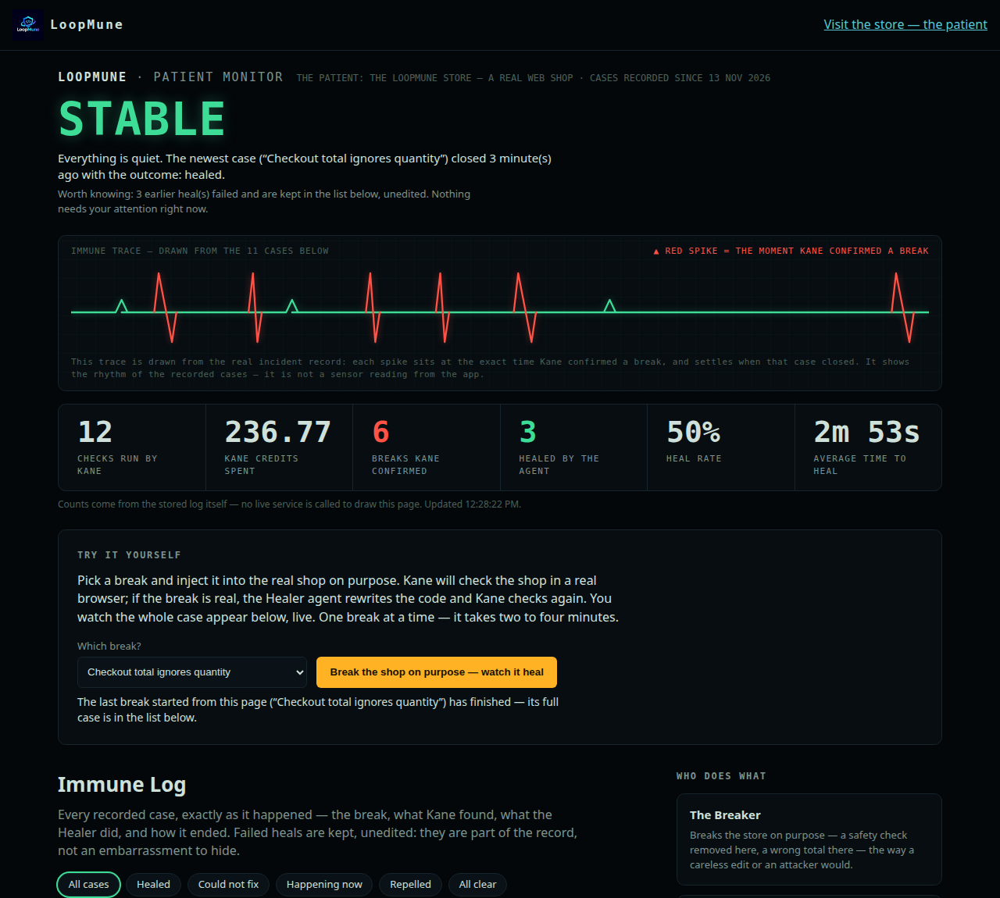
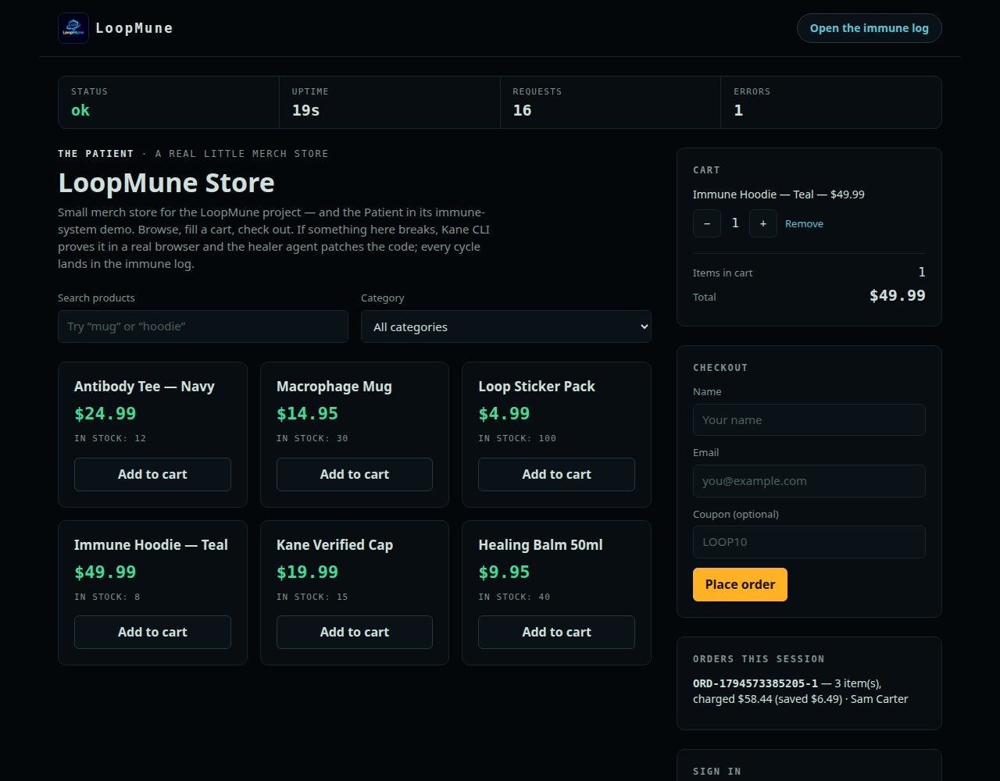

# LoopMune — a store with an immune system





LoopMune is a small, real merch store that can catch its own bugs and fix
them — with proof. Three actors run the loop:

- **The Breaker** breaks the store on purpose: a safety check removed
  here, a wrong total there — the way a careless edit or an attacker would.
- **Kane CLI — the Checker** opens the store in a real browser and uses it
  like a customer. Only Kane's verdict counts. If Kane says the store
  works, the break was not real.
- **The Healer** is an AI agent (Gemini). It reads Kane's failure report —
  bug title, summary, evidence signals — plus the broken source code,
  works out what is wrong, and rewrites the code. Then Kane checks again.

There is **no scripted fallback**: the Healer gets no answer key and no
patch table. If it cannot fix the code within three attempts, the incident
is recorded as *failed*, honestly. You can watch every round — attack,
verdict, patch, re-check — on the public **Immune Log** dashboard.

Built for the Kane CLI Online Hackathon (TestMu AI), Nov 12–19 2026.

## See it in under 30 seconds

```bash
npm start          # zero dependencies — plain Node.js, nothing to install
```

Open http://localhost:3000 — the store. Browse, search, fill a cart,
check out (coupon `LOOP10` takes 10% off). Then open the **Patient
Monitor** at http://localhost:3000/log.html: one big state word, the
immune trace drawn from the recorded cases, the vitals, and every case
told step by step with its Kane evidence. From that page you can also
**break the shop on purpose** — pick a catalog fault, inject it for
real, and watch the loop close live (one cycle at a time; needs the
Kane CLI and Healer access on the machine serving the page).

**No account is needed.** The store's primary flow has no login wall. The
sign-in form is a demo surface: it accepts any email with any non-empty
password (and its one hard rule — an empty password is always rejected —
is one of the things Kane patrols).

## Run the loop yourself

Live cycles need a Kane CLI account (sign up at testmuai.com, claim the
free credits, `npm install -g @testmuai/kane-cli`, sign in) and, for the
Healer, Gemini access. Everything else is in this repo.

```bash
npm run baseline                    # Kane smoke check vs the healthy store
npm run drill -- total-ignores-qty  # inject a break -> Kane proves it ->
                                    # the Healer patches -> Kane re-verifies
npm run watch                       # save-hook mode: edit any file in
                                    # patient/ and the loop reacts on save
npm test                            # 27 deterministic tests, no credits used
```

In save-hook mode the causality is the point: **save a file → Kane runs →
if it fails, the Healer reads the failure and edits the code → Kane runs
again → green.** A full timestamped recording of exactly that chain is in
the Immune Log (incident `inc-2026-11-13T12-11-21-275Z-coupon-anything`,
trigger: `hook`, outcome: healed).

## If a third-party service is down (the fallback)

The Healer depends on Gemini and verification depends on Kane's cloud.
The *record* of the loop does not: every incident — Kane's raw NDJSON
output, the parsed verdict, and the exact patch files the Healer wrote —
is stored in this repo under `evidence/<incident-id>/`, with the incident
history in `data/immune-log.jsonl`. The dashboard serves all of it with
no live Kane or LLM call, so judges can replay complete cycles from the
stored evidence alone. On a hosted copy without Kane CLI / Healer access
(for example the Render deploy from `render.yaml`), the "break it
yourself" button detects that and refuses honestly with the reason,
instead of recording a misleading failure — the recorded cases remain
the demonstration.

## The attack catalog

| Attack | Surface | What breaks |
|---|---|---|
| `total-ignores-qty` | cart totals | Total charges the unit price once, ignoring quantity |
| `coupon-anything` | checkout coupon | Any invented coupon code takes 50% off |
| `empty-cart-checkout` | checkout | An order is created with an empty cart |
| `login-empty-password` | sign in | Sign-in succeeds with an empty password |
| `negative-qty` | cart API | A negative quantity slips past the cart endpoint (API-probed; covered by the deterministic test suite — no UI quantity path exists for a browser test to exercise) |

Attacks are **real source mutations** in the Patient's logic modules
(`patient/cart.js`, `patient/checkout.js`, `patient/auth.js`), not runtime
flags — healing therefore means editing real code. Mutation anchors are
single structural lines and never contain prose, so a Healer that
legitimately rewords an error message cannot break re-injection.

## How it is built

```
server.js          Patient storefront + dashboard server (zero-dependency)
patient/           the store's business rules — the code that gets broken & healed
  catalog.js  cart.js  checkout.js  auth.js  errors.js
public/            storefront + the Patient Monitor dashboard (direction C
                   skin in monitor.css; trace.js builds the immune trace
                   from the recorded incidents, client-side)
lib/
  kane.js          the Kane Gate: runs one authored test, parses run_end NDJSON
  attacks.js       the catalog: mutation anchors + authored Kane prompts
  healer.js        M2: prompt building + lenient reply parsing (see below)
  patch.js         patch application: allow-list only, module-load check,
                   full rollback on any failure
  cycle.js         the immune state machine (inject -> verify -> heal -> verify)
  immune-log.js    append-only JSONL incident store (snapshot folding)
  breaker.js       the dashboard's break-it control: one guarded live
                   cycle (orchestrator child), availability-gated
orchestrator.js    baseline / drill / watch modes; manages the Patient process
kane/              the authored Kane tests, one file per check, with commands
tests/             stubbed-engine + API contract suites (no credits, no network)
data/              immune-log.jsonl — every recorded cycle
evidence/          per-incident Kane output (NDJSON + verdict) and Healer patches
render.yaml        Render blueprint (free web service, npm start)
screenshots/       the dashboard and storefront, as rendered
```

### Two bugs this project found in itself

The first hook-mode coupon cycle failed all three heal attempts, live.
Dissecting the Healer's real replies found two parsing failure modes:
(1) a literal newline inside the model's JSON summary string, and (2) the
Patient's own email regex copied into the JSON with single backslashes
(`\s`, `\.`) — invalid JSON escapes. `lib/healer.js` now repairs both,
inside string literals only, and regression tests reproduce the exact
payloads. The failed incidents are still in the log (`failed`, trigger
`hook`) — they are part of the evidence, not an embarrassment to hide.

## API notes (for the dashboard)

- `GET /api/log` → `{ incidents, orders }`. Each incident carries:
  `id`, `attack`, `attackName`, `surface`, `trigger`
  (`manual` | `drill` | `hook`), `startedAt`, `endedAt`, `finalStatus`
  (`passed` | `repelled` | `healed` | `failed` | `kane-error` | `error` |
  `running`), `kaneRuns[]` (`phase`, `at`, `exitCode`, `status`, `passed`,
  `credits`, `testUrl`, `evidence`), `healerAttempts[]` (`n`, `at`,
  prompt/response summaries, `patchFiles`, `patchEvidence`, `error`), and
  `events[]` — the status-transition timeline (`at`, `type`, `detail`)
  the dashboard's immune trace plots.
- `GET /api/summary` → aggregate vitals computed from the stored log:
  `counts` by outcome (incl. `active` = currently running), the freshest
  `lastKaneVerdict`, `lastIncidentAt`, `secondsSinceLastIncident`,
  `totalKaneCredits`, `totalKaneRuns`, `breaksConfirmed` (incidents with
  a confirmed infection), `healRate`, `meanHealSeconds`, and the
  `watchList` (each browser-verifiable catalog break with its newest
  recorded outcome). No live service calls.
- `GET /api/break/status` → the break-it control's state: whether a
  cycle is running, whether live cycles are available on this server,
  and the plain-language reason when they are not.
- `POST /api/break` `{ attackId }` → starts ONE real catalog cycle via
  the orchestrator (202), or refuses: 400 unknown / browser-less break,
  409 a cycle is already running, 503 live cycles unavailable here
  (no Kane CLI or no Healer access — e.g. a hosted copy).
- `GET /evidence/<incident-id>/<file>` serves the recorded Kane output
  and Healer patches.
- Store API: `GET /api/products?q=&category=`, `GET /api/cart`,
  `POST /api/cart/add|set|remove`, `POST /api/checkout`, `POST /api/login`,
  `GET /api/orders`, `GET /api/vitals`.

## License

MIT. Sample data uses neutral, fictional names only; no real person's
data, and no credentials of any kind, are in this repo.
